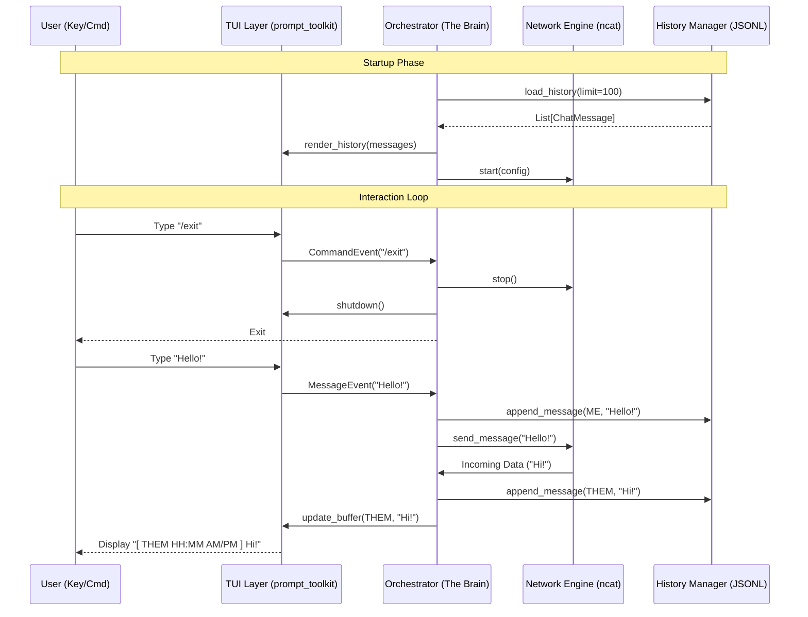

# Project Plan: Async Ncat Chat CLI

## Overview
A modular Python CLI application that acts as a wrapper for `ncat`. It provides a persistent chat history, a polished Text User Interface (TUI), and an extensible architecture that separates core logic from the UI.

## Architecture
The application follows a **Core-and-Shell** pattern:
- **Core (Logic Layer)**: Purely asynchronous, agnostic of the terminal. It handles configuration, file I/O (via thread pools), and network communication.
- **Shell (UI Layer)**: A TUI implementation using `prompt_toolkit` that consumes events from the Core and renders them.

### Component Breakdown
1.  **Environment Validator**: Checks system dependencies (`ncat`, `portalocker`).
2.  **Config Loader**: Parses and validates `config.toml` using `Pydantic`.
3.  **History Manager**: Handles JSONL-based persistent storage with schema versioning and async-wrapped sync I/O.
4.  **Network Engine**: Manent the `ncat` subprocess using `asyncio.create_subprocess_exec`.
5.  **TUI Interface**: Provides a scrollable terminal window, an input area at the bottom, and command processing (e.g., `/exit`).
6.  **Orchestrator**: The `main` loop that wires all components together and manages the global `asyncio` event loop.

## Tech Stack
- **Language**: Python 3.11+
- **Async Engine**: `asyncio`
- **Configuration**: `pydantic`, `tomllib`
- **TUI**: `prompt_toolkit`
- **Persistence**: `JSONL` (JSON Lines) via `portalocker` (run in `ThreadPoolExecutor`)
- **Network**: `ncat` (external binary)

## Workflow Diagram

